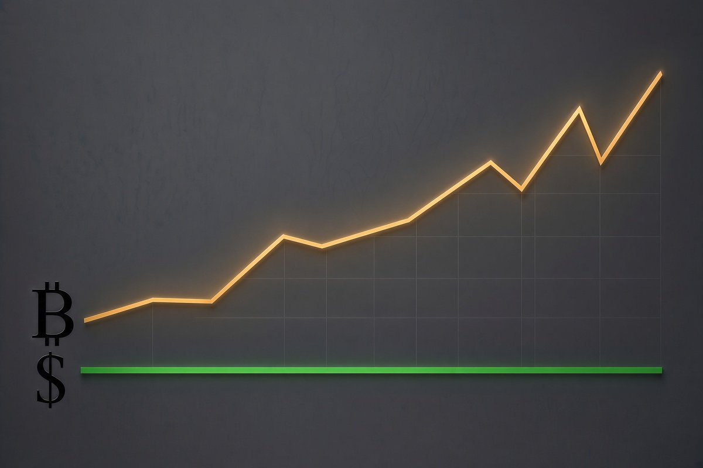
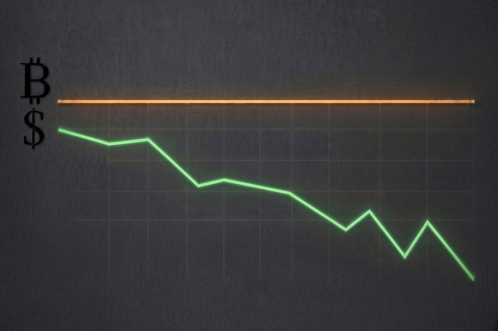

# 换一把尺子看世界

### 用比特币的视角，重新理解稳定与贬值

> 本文为观点文章，不构成投资建议。文中所引数据请以官方最新发布为准。

---

## 一、引子：我们从不怀疑尺子

如果一张桌子今天量出来是 1 米，明天量出来是 0.8 米，我们不会说桌子变矮了，而会说尺子变了。

但有一种尺子，每天都在变短，我们却从不怀疑它。我们用它衡量工资、衡量房价、衡量储蓄，衡量一切我们以为属于自己的财富。这把尺子，就是法币。

我们习惯了怀疑被量的东西——房价是不是泡沫，工资是不是太低，股票是不是高估——却很少怀疑那把尺子本身是否还准。

换个尺子，世界会完全不同。

---

## 二、常规视角：比特币波动，法币稳定

大多数人看比特币，就像下图一样：以美元计价，比特币价格大起大落，涨的时候令人兴奋，跌的时候令人恐惧。

于是，比特币被贴上“不稳定”的标签。法币则被视为更稳定的价值尺度——你手里的 100 元，明天还是 100 元，后天还是 100 元。

但这种“稳定”，是名义上的稳定，不是购买力上的稳定。

---

## 三、换尺子：以比特币计价，世界反过来

当你换一种计价单位，世界会翻转。

以比特币为尺度，1 BTC 永远等于 1 BTC。这不是说比特币没有价格波动，而是说它的发行规则不因政策或机构意志而改变。

真正的问题不是“1 单位等于 1 单位”——任何货币以自身计价都是 1=1，1 元也是 1 元，1 美元也是 1 美元。

**真正的问题在于：谁的供应会被不断稀释？谁的规则可以被随意改写？**

法币的“稳定”建立在一种隐性契约上：你相信发行者不会滥发。但这种契约没有数学约束，只有信用约束。

而比特币的“稳定”建立在代码上：总量上限 2100 万枚，这一限制自 2009 年比特币上线以来便已硬编码于协议之中，不由任何委员会决定，无法被任何政策修改。

---

## 四、机制：法币为什么容易贬值

法币体系的核心是弹性供应。

经济需要刺激，可以增发；政府债务到期，可以增发；金融系统出现危机，可以增发。这种弹性在短期内是工具，在长期内是代价——代价就是购买力的持续稀释。

看数据：

- 截至 2026 年 8 月，美国 M2 货币供应量已达约 23.3 万亿美元。
- 作为参照，1976 年 12 月美国 M2 约为 1.15 万亿美元。

也就是说，大约 50 年间，美国 M2 从 1.15 万亿增长到了 23.3 万亿，增长了约 20 倍。

| 年份 | 美国 M2（约） |
|---|---|
| 1976 | 1.15 万亿美元 |
| 1995 | 3.5 万亿美元 |
| 2005 | 6.68 万亿美元 |
| 2026 | 23.3 万亿美元 |

这不是某一年的异常值，而是持续了几十年的趋势。

比特币的供应规则完全不同。

2024 年 4 月 20 日，比特币完成第四次减半，挖矿奖励从 6.25 BTC 降至 3.125 BTC，每日新增发行量从约 900 枚减少至约 450 枚，年化供给通胀率降至约 0.83%。这一过程完全由代码预设的共识规则自动执行，不由任何机构决定。

法币的供应取决于人的决定，比特币的供应取决于数学。这就是本质区别。

---

## 五、生活证据：100 美元的购买力

把视角拉回到日常生活，事情会更清楚。

- 1975 年的 100 美元，到 2025 年只剩下约 16.4 美元的购买力，缩水了约 84%。
- 自 1925 年以来，美元已经失去约 95% 的购买力。

也就是说，一百年前你存下的 100 美元，今天只能买到当年约 5 美元的东西。

如果一张桌子今天 1 米、明年 0.8 米，我们不会说桌子变高了，我们会说尺子出了问题。

法币购买力的持续下降，本质上就是尺子在缩短。

---

## 六、结尾：换尺子不是换信仰，是换问题

你不一定要买比特币，也不一定要相信它会取代法币。

但你可以开始做一件事：**怀疑那把尺子**。

- 当有人说“比特币波动太大”时，你可以问：以什么计价？
- 当有人说“法币很稳定”时，你可以问：名义稳定，还是购买力稳定？
- 当有人说“你的存款在增长”时，你可以问：增长的是数字，还是能买到的东西？

30 年前的 100 美元和现在的 100 美元，数字没变，能买到的东西变了。

变的是尺子。

**换一把尺子，不是为了得出不同的答案，而是为了开始问不同的问题。**

比特币的价值不在于它完美，而在于它提供了一种不同的可能性：一种供应规则不能被随意改写的货币实验。它迫使你面对一个你从未问过的问题——我们习以为常的“稳定”，究竟是谁定义的稳定？
